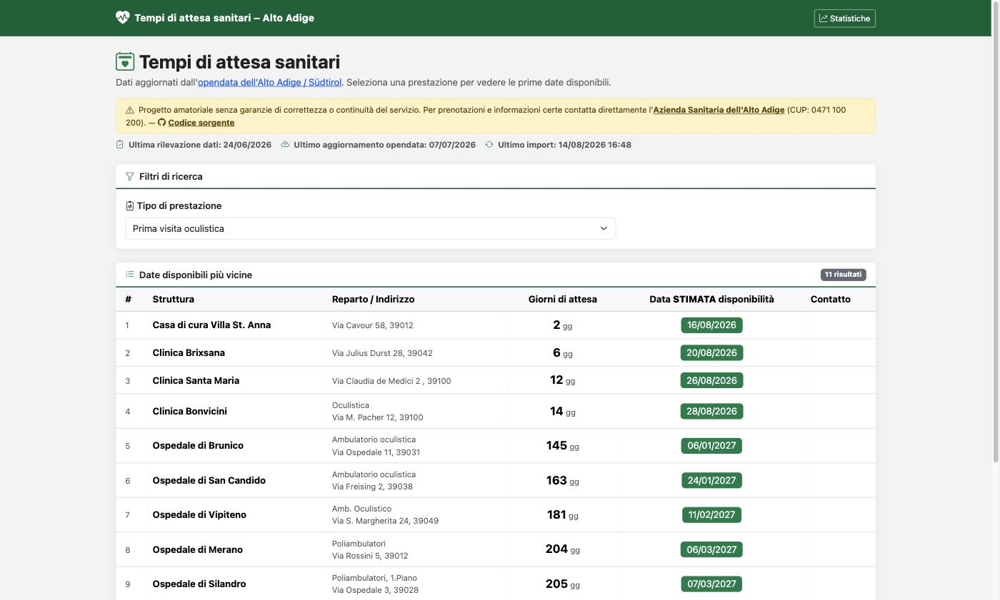

# Attese

Cruscotto pratico per consultare i **tempi di attesa delle prestazioni sanitarie** in Provincia di
Bolzano/Alto Adige: cerchi una prestazione (es. "Prima visita oculistica") e vedi subito quali
strutture hanno le date più vicine, ordinate per giorni di attesa.



## Cosa fa

- Scarica automaticamente i dati opendata della Provincia di Bolzano
- Mostra, per ogni prestazione, le strutture con le date disponibili più vicine
- Tiene traccia nel tempo dell'andamento dei tempi medi di attesa, globale e per prestazione

## Dati

I dati provengono dall'[Open Data Hub dell'Alto Adige](https://data.civis.bz.it/it/dataset/southtyrolean-healthservices-waitingtimes),
pubblicati dalla Provincia Autonoma di Bolzano sotto licenza CC Zero.

## ⚠️ Avvertenza

Questo progetto non ha nessuna affiliazione ufficiale con la Provincia di Bolzano o l'Azienda
Sanitaria dell'Alto Adige. **Non garantiamo la correttezza, la completezza o l'aggiornamento dei
dati mostrati.**

Per prenotare una prestazione o ottenere informazioni certe sui tempi di attesa, contatta
direttamente l'**Azienda Sanitaria dell'Alto Adige**:
- Sito: [www.sabes.it](https://www.sabes.it)
- CUP (prenotazioni): 0471 100 200

## Stack tecnico

- [Django](https://www.djangoproject.com/) 6 + [Celery](https://docs.celeryq.dev/) (aggiornamento dati giornaliero)
- [PostgreSQL](https://www.postgresql.org/) + [Redis](https://redis.io/) (broker Celery)
- [HTMX](https://htmx.org/) + [Bootstrap 5](https://getbootstrap.com/) + [Chart.js](https://www.chartjs.org/)
- [django-allauth](https://docs.allauth.org/) con Google OAuth per l'accesso all'area admin (nessuna
  registrazione pubblica: la ricerca è liberamente consultabile da chiunque, senza login)
- Container [Podman](https://podman.io/)/Docker, WSGI con [gunicorn](https://gunicorn.org/)

## Avvio in locale

Richiede [Podman](https://podman.io/) (o Docker) con il plugin compose.

```bash
git clone git@github.com:azuki-beans/attese.git
cd attese
podman compose -f stacks/stack-local.yml up -d --build
podman compose -f stacks/stack-local.yml exec web python manage.py migrate
podman compose -f stacks/stack-local.yml exec web python manage.py fetch_waitingtimes
```

L'app è su [http://localhost:8000](http://localhost:8000). `stacks/stack-local.yml` include già
Postgres, Redis, Celery (worker + beat, che aggiorna i dati ogni giorno alle 06:00) e
[Mailpit](https://github.com/axllent/mailpit) per intercettare le email in locale — non serve
configurare nulla per iniziare a usare l'app.

Per accedere all'area admin (`/django-admin/`) serve invece un client OAuth Google: vedi la sezione
[Login admin (Google OAuth)](#login-admin-google-oauth) più sotto.

### Test rapidi

```bash
podman compose -f stacks/stack-local.yml exec web python manage.py check
podman compose -f stacks/stack-local.yml exec web python manage.py test
```

## Login admin (Google OAuth)

L'accesso a `/django-admin/` è protetto da login Google, ma **accetta solo utenti già esistenti
con `is_staff=True`**: non crea nuovi account automaticamente (vedi `accounts/adapters.py`). Per
usarlo serve un client OAuth su [Google Cloud Console → Credentials](https://console.cloud.google.com/apis/credentials):

1. Crea un client OAuth 2.0 di tipo "Applicazione web".
2. URI di reindirizzamento autorizzato: `<SITE_URL>/accounts/google/login/callback/` (in locale
   `http://localhost:8000/accounts/google/login/callback/`).
3. Imposta `GOOGLE_CLIENT_ID` e `GOOGLE_CLIENT_SECRET` nel tuo `.env`/variabili d'ambiente.
4. Crea un superuser o uno staff user via `python manage.py createsuperuser` con la stessa email
   dell'account Google che userai per accedere.

## Deploy su un server proprio

Il progetto è pensato per girare dietro un reverse proxy (nginx, Caddy, Traefik...) che termina
l'HTTPS e inoltra a Django in HTTP. `config/settings.py` è già configurato per fidarsi
dell'header `X-Forwarded-Proto`.

1. Copia `stacks/stack-prod.yml` e crea un file `.env` accanto (vedi `.env.example` per la lista
   completa delle variabili: `SECRET_KEY`, `POSTGRES_PASSWORD`, `ALLOWED_HOSTS`,
   `GOOGLE_CLIENT_ID`/`SECRET`, SMTP, `SITE_URL`, `CSRF_TRUSTED_ORIGINS`, ...).
2. Avvia lo stack:
   ```bash
   podman compose -f stacks/stack-prod.yml --env-file .env up -d
   ```
   Include Postgres, Redis, l'app web, Celery worker e Celery beat (che aggiorna i dati ogni
   giorno alle 06:00). Le immagini sono quelle pubblicate su `ghcr.io/azuki-beans/attese` dalla
   CI a ogni push su `main`.
3. Configura il reverse proxy per inoltrare a `attese:8000` (nome del servizio nello stack),
   impostando `X-Forwarded-Proto` e `Host`:
   ```nginx
   location / {
       proxy_pass http://attese:8000;
       proxy_set_header Host              $host;
       proxy_set_header X-Forwarded-Proto  $scheme;
       proxy_set_header X-Forwarded-Host   $host;
   }
   ```
4. Registra l'URI di redirect HTTPS pubblico (`https://tuodominio/accounts/google/login/callback/`)
   sul client OAuth Google.

## Deploy su Google Cloud Run

Il container si adatta automaticamente alla variabile `$PORT` iniettata da Cloud Run (default
8000 se non impostata). Su Cloud Run **non serve Celery/Redis**: l'unico task periodico è
l'importazione giornaliera dei dati, che su Cloud Run conviene far girare come **Cloud Run Job**
schedulato da **Cloud Scheduler**, invece di tenere sempre accesi worker e beat.

1. **Database**: crea un'istanza [Cloud SQL per PostgreSQL](https://cloud.google.com/sql/docs/postgres).
   Cloud Run può collegarcisi via socket Unix senza esporre un IP pubblico.
2. **Immagine**: riusa quella pubblicata dalla CI su `ghcr.io/azuki-beans/attese:main`, oppure
   builda con Cloud Build.
3. **Servizio web**:
   ```bash
   gcloud run deploy attese \
     --image ghcr.io/azuki-beans/attese:main \
     --region europe-west3 \
     --add-cloudsql-instances PROJECT:REGION:INSTANCE \
     --set-env-vars DEBUG=0,POSTGRES_HOST=/cloudsql/PROJECT:REGION:INSTANCE,POSTGRES_DB=attese,POSTGRES_USER=attese,ALLOWED_HOSTS=attese-xxxx.a.run.app,SITE_URL=https://attese.azukibeans.dev,CSRF_TRUSTED_ORIGINS=https://attese.azukibeans.dev \
     --set-secrets POSTGRES_PASSWORD=attese-db-password:latest,SECRET_KEY=attese-secret-key:latest,GOOGLE_CLIENT_ID=attese-google-client-id:latest,GOOGLE_CLIENT_SECRET=attese-google-client-secret:latest \
     --allow-unauthenticated
   ```
4. **Import giornaliero dati** come Cloud Run Job, con le stesse variabili d'ambiente del
   servizio ma comando diverso:
   ```bash
   gcloud run jobs create attese-fetch \
     --image ghcr.io/azuki-beans/attese:main \
     --region europe-west3 \
     --add-cloudsql-instances PROJECT:REGION:INSTANCE \
     --set-env-vars POSTGRES_HOST=/cloudsql/PROJECT:REGION:INSTANCE,POSTGRES_DB=attese,POSTGRES_USER=attese \
     --set-secrets POSTGRES_PASSWORD=attese-db-password:latest \
     --command python --args manage.py,fetch_waitingtimes

   gcloud scheduler jobs create http attese-fetch-daily \
     --schedule "0 6 * * *" \
     --uri "https://REGION-run.googleapis.com/apis/run.googleapis.com/v1/namespaces/PROJECT/jobs/attese-fetch:run" \
     --http-method POST \
     --oauth-service-account-email SCHEDULER_SA@PROJECT.iam.gserviceaccount.com
   ```
5. **Dominio custom**: mappa `attese.azukibeans.dev` al servizio Cloud Run con
   [`gcloud run domain-mappings create`](https://cloud.google.com/run/docs/mapping-custom-domains),
   poi registra lo stesso URI di redirect HTTPS sul client OAuth Google.
6. `python manage.py migrate` va eseguito una volta al primo deploy (e a ogni migrazione nuova),
   ad esempio con `gcloud run jobs execute` su un job dedicato, oppure a mano via
   `gcloud run services proxy` + shell locale.

## Licenza

Distribuito con licenza Apache 2.0 — vedi [LICENSE](LICENSE).

## Contribuire

Pull request e segnalazioni di bug sono benvenute.
